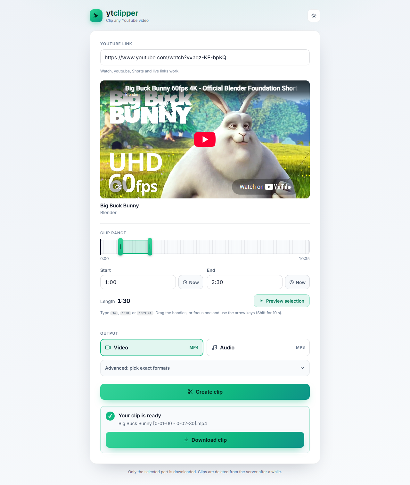

# ytclipper-go

[](https://github.com/MorrisMorrison/ytclipper-go/actions/workflows/ci.yml)
[](https://codecov.io/gh/MorrisMorrison/ytclipper-go)

Cut a clip out of any YouTube video and download it. Paste a link, drag the range, get a file.

ytclipper is a small self-hostable web app: a Go server with a plain HTML/JS page in front of [yt-dlp](https://github.com/yt-dlp/yt-dlp) and [FFmpeg](https://ffmpeg.org/). Only the selected section is downloaded, not the whole video. No database, no accounts; clips are deleted automatically after a while.

<p align="center">
  <picture>
    <source media="(prefers-color-scheme: dark)" srcset="docs/screenshot-dark.png">
    
  </picture>
</p>

<sub>Screenshot rendered with <code>make screenshots</code>. Video: <a href="https://peach.blender.org/">Big Buck Bunny</a> © Blender Foundation, CC BY 3.0.</sub>

## Features
- The YouTube player loads as soon as you paste a link; nothing waits on the server.
- **Swap the domain:** replace `www.youtube.com` (or `youtu.be`) in any YouTube link with your ytclipper host, e.g. `https://ytclipper.example/watch?v=dQw4w9WgXcQ` or `https://ytclipper.example/shorts/…`, and the editor opens with that video. A timestamp in the link (`t=90`, `t=1m30s`) becomes the clip start.
- Pick the range with a two-handle slider under the player (drag, or arrow keys), by typing times (`34`, `1:28` or `1:09:24`), or with "Now" buttons that take the player's current time. **Preview selection** plays just that range.
- One click for a video (H.264/AAC MP4) or audio (MP3) clip. **Advanced** lists every format YouTube offers (resolution, fps, codec, estimated clip size) so you can combine a video and an audio stream yourself.
- Downloads get a readable name: `<title> [from - to].<ext>`.
- Clips are processed as background jobs; the page shows their progress and starts the download when the job is done.
- Works on phones; light and dark theme (follows the system until you pick one).
- The page is plain HTML, CSS and ES modules: no framework, no build step.
- For self-hosting: per-IP rate limiting, optional basic auth, automatic cleanup of old clips, a `/health` endpoint, and an optional proxy for yt-dlp.

## Quick start

### Docker (recommended)
The image bundles yt-dlp, FFmpeg and deno.

```bash
docker run -d -p 8080:8080 ghcr.io/morrismorrison/ytclipper-go:latest
```

**Image tags.** `:latest` follows `main` (every merged change). To stay on a release instead, pin its version, e.g. `ghcr.io/morrismorrison/ytclipper-go:0.0.1`; see the [releases](https://github.com/MorrisMorrison/ytclipper-go/releases). ytclipper is pre-1.0: releases are snapshots on the way to a stable 1.0, not long-term-supported versions.

Then open http://localhost:8080. With Docker Compose, `docker compose up -d` uses the included `docker-compose.yml` (port 8080, clips in a named volume). The container runs as a non-root user.

### From source
Requirements: Go (see `go.mod`), [yt-dlp](https://github.com/yt-dlp/yt-dlp#installation), FFmpeg, and [deno](https://deno.com/) (yt-dlp uses it to solve YouTube's JavaScript challenges).

```bash
git clone https://github.com/MorrisMorrison/ytclipper-go.git
cd ytclipper-go
go run ./cmd/ytclipper
```

The server checks for `yt-dlp` and `ffmpeg` on startup and exits if either is missing. The page and its static files are embedded in the binary, so it runs from any directory.

## Documentation
- [Configuration](docs/configuration.md): all `YTCLIPPER_*` settings, the proxy for YouTube (HTTP, not SOCKS), running behind a reverse proxy.
- [API](docs/api.md): the JSON endpoints the page uses, with request and response examples.
- [Development](docs/development.md): layout, `make` targets, unit and e2e tests, coverage, contributing.

## License
[MIT](LICENSE)
